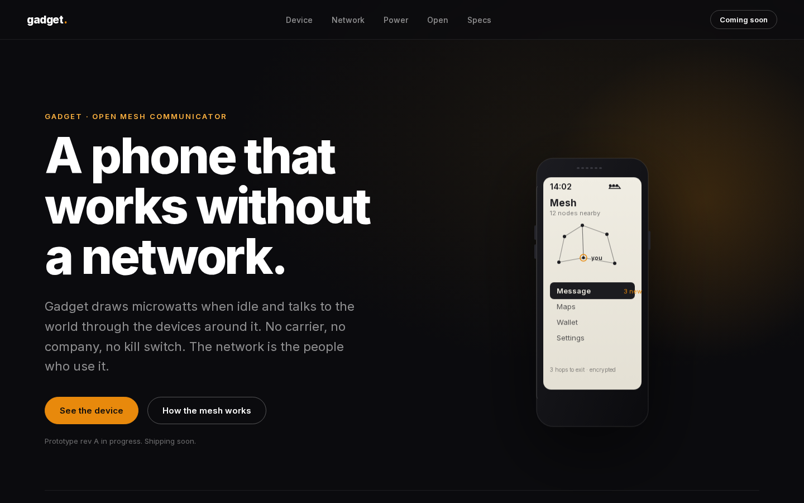

# Gadget

An open, low-power, phone-shaped mesh communicator. Hardware and software
designed from zero. Not for profit, for people.

The device looks like a phone, draws microwatts when idle, and talks to the
world over a mesh formed by the devices around it. Internet access comes
from home exit nodes run by the people who use them. No company has to
keep the network alive.

## Status

Architecture locked. PCB rev A schematic in progress. Firmware scaffold
compiles for the rev A board (hello world on the nRF54L15). Product page
in `web/`, destined for gadget.thingg.co.

## What it is

Three roles, one design:

- **Handset.** ARM board, Cortex-M33: Nordic nRF54L15, dual SX1262 LoRa
  radios, e-ink display, GPS, 3000 mAh cell. Long-range LoRa mesh plus a
  2.4 GHz data plane with 20 concurrent Bluetooth links per node.
- **Home base station.** The same core with an SX1303 16-channel LoRa
  concentrator and Ethernet. Long-range hub, SDN controller, and exit node
  for the neighborhood.
- **Software.** Zephyr, OpenThread, and a custom SDN-style stack. Control
  plane on LoRa, data plane on 2.4 GHz, payments in Bitcoin Lightning.

## Repository map

- `docs/architecture.md` - the full design
- `docs/decisions.md` - architecture decision records
- `docs/hardware-spec.md` - BOM, pin map, power budget
- `hardware/` - KiCad project, rev A schematic in progress
- `firmware/` - Zephyr application, builds for the rev A board
- `web/` - product page for gadget.thingg.co

## Building the firmware

Requires the nRF Connect SDK v3.3.4 workspace and the Zephyr SDK 0.16.x
(arm-zephyr-eabi) on the host. See `firmware/README.md` for the full
toolchain setup. The application and its custom `gadget/nrf54l15/cpuapp`
board target live in `firmware/app`; point `BOARD_ROOT` at the app so the
build system finds the board:

```sh
BOARD_ROOT=firmware/app west build -b gadget/nrf54l15/cpuapp firmware/app
```

## Product page



A static page, no build step. Serve `web/` with any static host and point
gadget.thingg.co at it. The waitlist form posts to `/api/waitlist`; wire that
to a real endpoint, or drop the form.

## Licenses

- Firmware: PolyForm Noncommercial 1.0.0 (`LICENSE-SOFTWARE.txt`)
- Hardware: CERN-OHL-NC v1.0 (`LICENSE-HARDWARE.txt`)
- Documentation: CC BY-NC 4.0 (`LICENSE-DOCS.txt`)

Everything is noncommercial by deliberate choice. The point is a device
that helps people, not a device that makes money.
